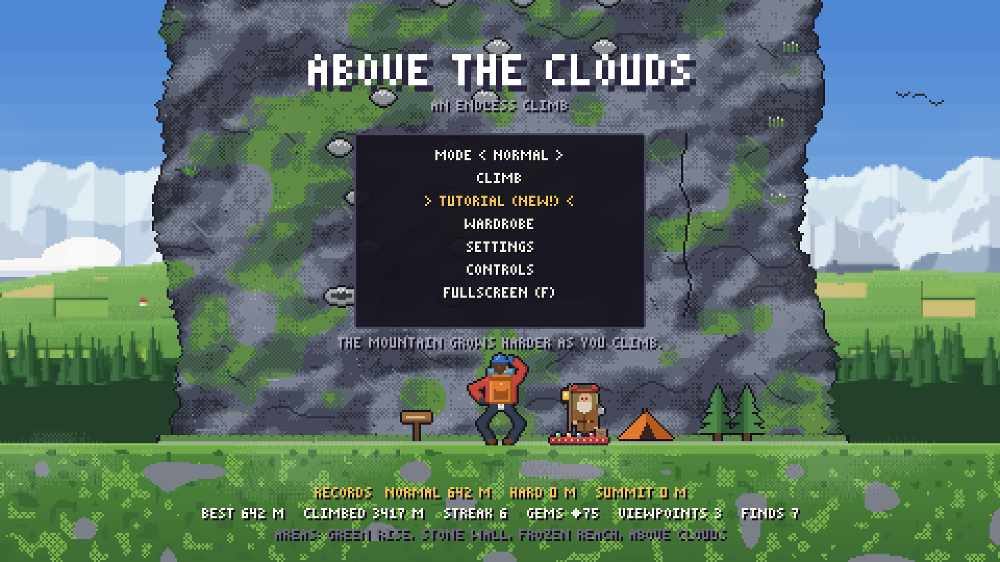
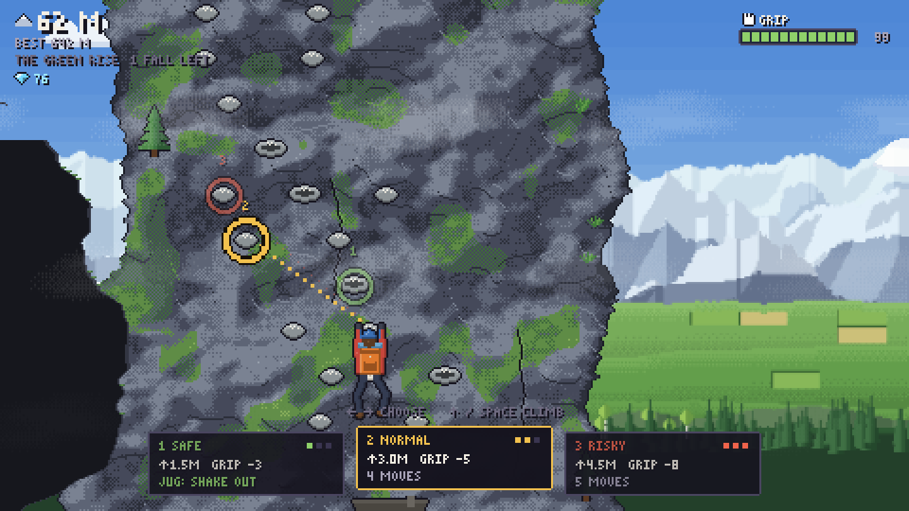
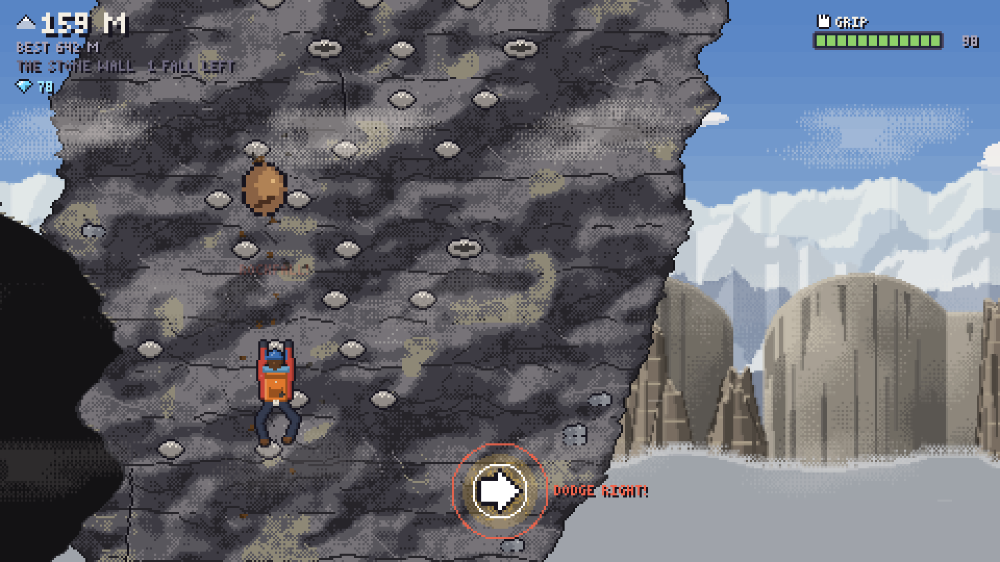
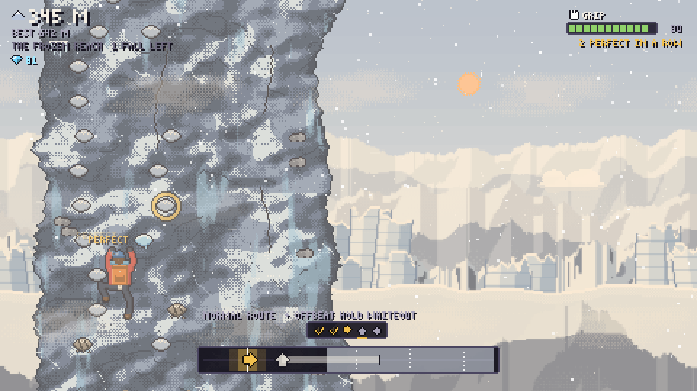
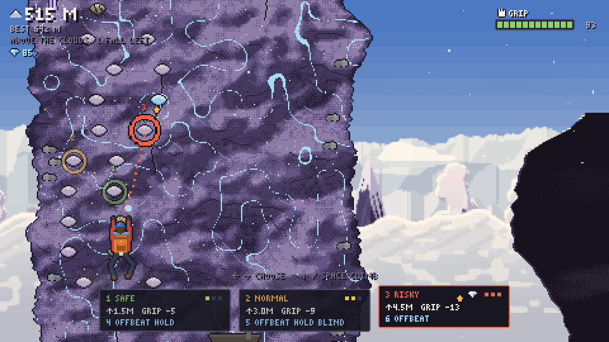
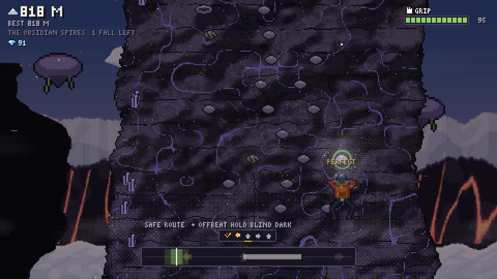
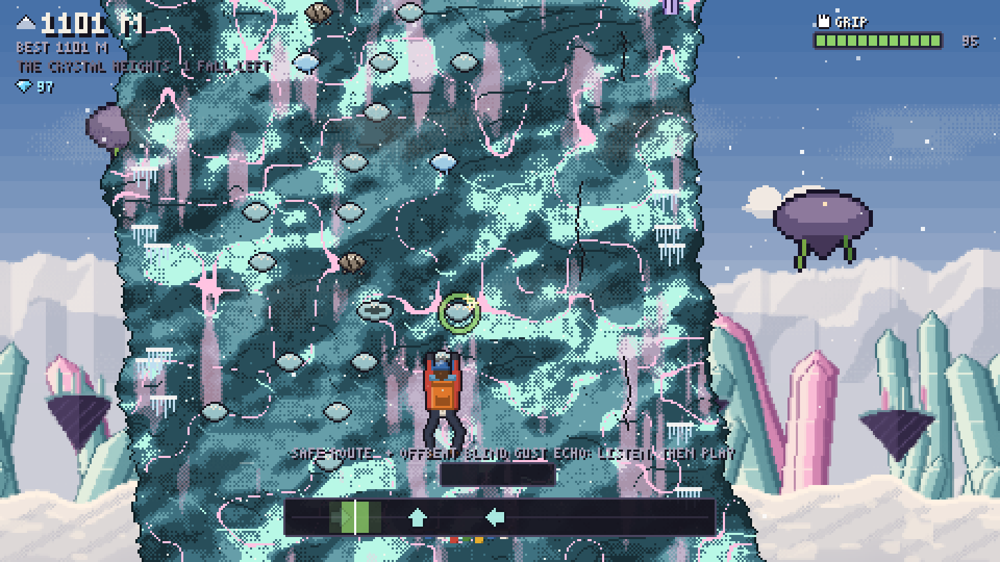

# Above the Clouds

**An endless pixel-art climbing game where every move is a rhythm.** Pick a route up the
wall, then climb it by pressing a short run of directions on the beat. Grip is your only
resource, the mountain never ends, and every part of it plays by its own rules.

**[▶ Play in your browser](https://mlbru.github.io/Above-The-Clouds/)** · keyboard, mouse or touch · no install



## Six biomes, five twists

The mountain climbs through six biomes. Each has its own scenery in the distance, its own
rock, weather and music, and (above the first) its own mechanic. Above 1300 m the three
highest biomes take turns, forever.

| | Biome | What changes |
| --- | --- | --- |
|  | **The Green Rise**<br>0 m | The calm start: meadows, a winding river and pine forest below. No twist, just the climb. |
|  | **The Stone Wall**<br>120 m | **Rockfall.** Rocks come down as you grab a hold. Press the shown direction on the beat to dodge; a hit costs grip, a clean dodge feeds your streak. |
|  | **The Frozen Reach**<br>300 m | **Whiteout.** Blizzards roll in. Notes only appear just before the line, but gems turn up twice as often. Wait it out on a ledge, or climb on by feel. |
|  | **Above the Clouds**<br>480 m | **Thermals.** Some routes ride warm air. Hit the orange up-note perfectly and the updraft lifts you 3 m higher. |
|  | **The Obsidian Spires**<br>800 m | **Darkness.** The black glass swallows the light. Notes are faint shapes that flash up on every beat, and your headlamp comes on. |
|  | **The Crystal Heights**<br>1050 m | **Echo crystals.** A crystal sings the rhythm first; then you play it back from memory. A perfect echo pays out grip. |

## How it plays

- **Choose a route.** Safe, normal or risky: higher routes gain more height but cost more
  grip and have longer, trickier rhythms.
- **Climb on the beat.** Arrows slide into the line; press ← ↑ → in time. Perfect hits cost
  almost no grip, misses cost a lot.
- **Rest on ledges.** Ledges refill your grip and are your checkpoints.
- **One free fall per biome.** Fall once and you are back at your last ledge. Fall a second
  time in the same biome and the run is over: back to 0 m.
- **Collect and spend.** Every biome has its own gem. Spend them at the trader at base camp
  on gear, perks and clothes.

Three modes: **Normal**, **Hard** (stricter timing, hungrier grip) and **Summit** (one fall
ends the run). Each keeps its own record.

## Run locally

```
npm install
npm run dev        # http://localhost:5183
npm test           # logic tests (node:test)
npm run build      # production build in dist/
node tests/balanceSim.mjs   # Monte-Carlo balance check
```

URL flags: `?seed=123` (reproducible mountain), `?play` (skip title),
`?timer` (setTimeout game loop for background tabs), `?harness` (loads the in-browser
integration tests; run `await __runHarness()` in the console).

## Tutorial

**TUTORIAL** on the title screen opens the Training Crag: a short hand-built wall
(`src/data/tutorial.js`) with one lesson per feature, played with the real mechanics. Bram,
the base camp trader, coaches you in short speech bubbles while you play (the game does not
stop), points at what he talks about, and gives each lesson a small goal with a checkmark.
A tag shows when the feature appears in a real run (calculated from `balanceConfig.js`).
Finishing it the first time pays 15 gems; the pause menu can skip it.
URL flag: `?tutorial` jumps straight in.

## Game details

- **The mountain gets harder as you climb**: the beat speeds up, timing windows shrink,
  climbs get longer (up to 7 inputs) and rest ledges spread out (`ramp` in `balanceConfig.js`).
- **Tricks unlock with height**: off-beat rhythms (40 m+), crumbling holds that break after a
  few seconds (150 m+), wind gusts with tighter timing (250 m+), hold notes (180 m+), and
  blind notes that fade out before the line (380 m+).
- **Perfect streaks**: consecutive perfect moves are counted under the grip meter. At 10, 20
  and 30 (then every 10) you get grip back; 20 and 30 in a row unlock the Golden Beanie and
  the Blaze jacket (`streak` in `balanceConfig.js`).
- **Record marker**: a dashed gold line with a flag shows your record height for the current
  mode on the wall, and fades when you pass it.
- **Feedback**: perfect hits flash the climber, burst a ring and play a note that climbs with
  the streak. The streak counter grows and catches fire at 10/20, and shatters when broken.
  New biomes get a typed title card, every 100 m shows a banner, and beating your record
  sets off a fanfare with confetti.
- **Rockfall** (Stone Wall): every 30-50 s a rockfall greets you as you grab a hold. A rock
  drops onto you on the beat; press the shown direction (left/right) to dodge. From 210 m two
  rocks come in a row. A hit costs 12 grip, a clean dodge counts towards your perfect streak
  (`ROCKFALL` in `src/systems/mechanics/Rockfall.js`).
- **Thermals** (Above the Clouds): sometimes one route carries a thermal (warm up-arrow on
  its card and next to its hold). Hit the orange up-note perfectly and the updraft lifts you
  3 m higher after the climb; any other hit is a normal climb (`THERMALS` in
  `src/systems/mechanics/Thermals.js`).
- **Darkness** (Obsidian Spires): the black glass swallows the light. Notes on the track are
  faint shapes that flash up on every beat (blind notes flash too) and the headlamp comes on
  (`DARKNESS` in `src/systems/mechanics/Darkness.js`).
- **Echo** (Crystal Heights): some shorter routes carry an echo crystal (cyan spark on the
  card). The crystal first plays the rhythm with chimes; then you play it back with the notes
  and sequence hidden, with slightly wider windows. A fully perfect echo gives +15 grip, and
  echo routes carry gems more often (`ECHO` in `src/systems/mechanics/Echo.js`).
- **Whiteout** (Frozen Reach): now and then a blizzard rolls in, announced by a toast. During
  the storm the scene washes out and notes only appear shortly before the line (blind notes
  stay visible), but gems turn up twice as often. Wait it out on a ledge or climb through it
  (`WHITEOUT` in `src/systems/mechanics/Whiteout.js`).
- **Gems**: a route can carry a gem on its target hold (also shown on its route card). Take
  that route to grab it; the other routes' gems fade away. Risky routes carry gems most
  often. Every area has its own stone (emerald, amber, sapphire, cloud opal, ruby, diamond),
  rarer and worth more the higher you go. Every 50 m of height, perfect-streak milestones
  and a new record add a few gems; Hard pays x1.5, Summit x2 (`GEM_INCOME` in `src/data/shop.js`).
- **The trader** stands at base camp (T, or tap them). GEAR: one-use items, pack up to 3;
  they are used up when you leave base camp at the start of a Normal run (chalk bag,
  energy bar, crampons, quickdraws, spare rope, lucky charm). PERKS: bought once, one active
  at a time (gem sense, iron grip, steady hands, streak saver). STYLE: buy clothes and chalk
  colours; some need a number of found regional gems first. Gear and perks only work in Normal.
- **Wardrobe**: in the pause menu, on the title screen and at the trader. It lists only what
  you own; the STYLE tab shows everything you can still earn or buy.
- **One free fall per biome** (Normal and Hard): the first fall in a biome sends you back to
  your last checkpoint as before; a second fall in the same biome ends the run and you start
  again at 0 m. The HUD shows `1 FALL LEFT` or `NO FALLS LEFT` next to the biome name. Summit
  keeps its own rule: one fall ends the run.
- **Modes** (title screen): Normal, Hard (stricter timing, hungrier grip, no perfect refills,
  faster ramp) and Summit (Hard rules, and one fall ends the run). Each mode has its own record.

## Biomes

Everything that makes a part of the mountain different lives in its entry in
`src/data/biomes.js`: palette, timing and grip numbers, weather, music, wall overlays
(`src/render/wallOverlays.js`), decor swaps, rest ledges and viewpoint names, backdrop
layers and sky tint (`src/render/backdropArt.js`) and an optional mechanic
(`src/systems/mechanics/`). Adding or changing a biome should not need edits elsewhere.

## Codes

Settings > ENTER CODE (title screen or pause menu). Entering a code again switches it off.
- `GEMSTORM`: unlimited gems (and every regional-gem requirement counts as met), for testing the trader.

## Controls

| Action | Keys |
| --- | --- |
| Choose route | ← → / A D / 1 2 3 / mouse |
| Start climb | ↑ / W / Space / Enter |
| Climb inputs | ← ↑ → / A W D, on the beat (keep held for hold notes) |
| At a ledge | R rest · V view · C photo · T trader (base camp) · Space climb |
| Trader / wardrobe | ↑ ↓ choose · ← → pack / change · Space buy / wear · Q E tabs · Esc leave |
| Pause | Esc / P |
| Debug overlay | F3 or ` (then B cycles the autopilot) |

## Deploy

Every push to `main` runs the tests, builds the game and publishes it to GitHub Pages
(`.github/workflows/pages.yml`).

## Shareable files (`npm run release`)

Written next to the project folder:
- `above-the-clouds.html`: one file to double-click on a computer. Touch buttons appear automatically on touch screens.
- `above-the-clouds-mobile.html`: the same game with the touch buttons always on.
- `above-the-clouds-web.zip`: contains `index.html`, ready to upload to itch.io, Netlify or GitHub Pages.

On phones: play in landscape. The game leaves room at both sides for the buttons
(◀ / ▲ on the left, ▲ / ▶ on the right). Holding a button works for hold notes. Tap route
cards and menu items directly, and use the PAUSE button at the top.

## Structure

- `src/config/` — `gameConfig.js` (resolution, depths), `balanceConfig.js` (all tuning)
- `src/systems/` — pure logic: `ComboSystem`, `GripSystem`, `SegmentGenerator`
  (`Mountain`), `ProgressionSystem`, `DayNightSystem`; plus Phaser-side `WeatherSystem`,
  `Effects`, and procedural `AudioSystem`
- `src/data/` — combo patterns, biomes, segment templates, cosmetics, gems, trader goods
  (`shop.js`), discoveries, audio manifest
- `src/render/` — procedural pixel art (climber poses, holds, decor, backgrounds, wall painter)
- `src/world/` — parallax `Background`, per-segment `WallRenderer`
- `src/entities/Climber.js`, `src/ui/*`, `src/scenes/*`

## Replacing assets

- Audio: add `{ key, url }` entries to `src/data/audioManifest.js` with keys like `grab`,
  `boot`, `slip`, `perfect`. A loaded file replaces that synthesized sound; missing files
  are ignored.
- Art: every texture is created under a fixed key in `src/render/textures.js`
  (e.g. `climber` with named frames, `hold_<biome>_<kind>_<hazard>`, `decor_*`, `bg_*`).
  Load a sheet under the same key to replace it.
